# Gamificação do Acompanhamento Estratégico

Relatório de apresentação do protótipo · Vice-Presidência · Produtiva Júnior

> Os números deste relatório são de uma base de demonstração (dados fictícios). As regras de pontuação são uma proposta em validação, e os valores do PIPJ são ilustrativos.

## 1. Objetivo

Este relatório apresenta o protótipo do módulo de **Gamificação do Acompanhamento Estratégico**, proposto no Plano de Ação da Vice-Presidência (OKR 1, KR 1.2). O módulo é uma nova área do sistema estratégico da VP. Ele transforma o registro das atividades dos núcleos em pontos, ranking e indicadores, e liga esse resultado ao reconhecimento na RG e ao PIPJ.

O protótipo serve para mostrar à diretoria e aos núcleos como a proposta funcionaria na prática, antes de qualquer desenvolvimento definitivo.

## 2. O problema que a gamificação resolve

Hoje a gerente da VP acompanha o tático de cada núcleo a cada 15 dias e no início de cada batalha. As atividades são registradas no Monday, mas:

- não existem indicadores para comparar a execução dos núcleos;
- muita atividade é feita e não é registrada, e por isso não aparece no acompanhamento;
- não há um incentivo claro para manter o status das atividades atualizado.

A gamificação cria esse incentivo: registrar e cumprir prazos passa a dar pontos ao núcleo, e deixar atividades sem registro ou com status desatualizado tira pontos.

## 3. Como funciona, em 4 etapas

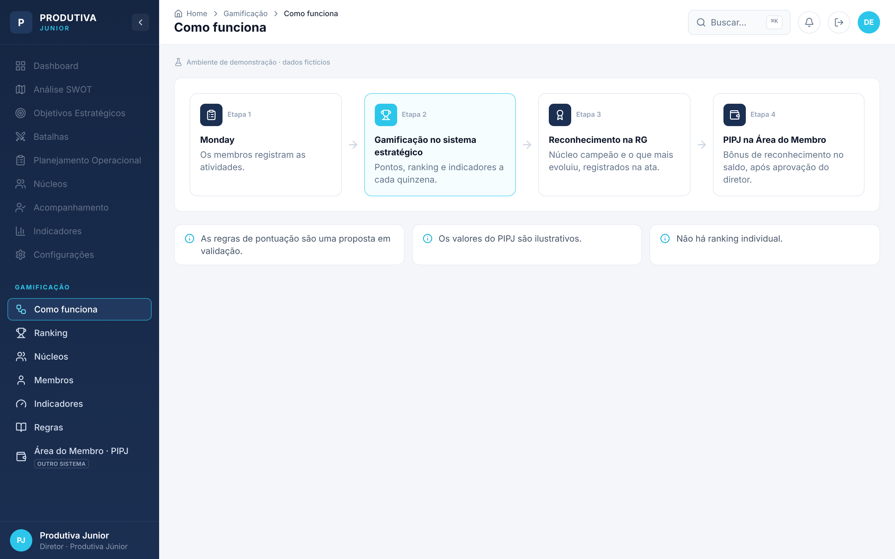

1. **Monday:** os membros registram as atividades do núcleo, como já fazem hoje.
2. **Gamificação no sistema estratégico:** a cada quinzena, o sistema calcula os pontos, o índice de cada núcleo, o ranking e os indicadores.
3. **Reconhecimento na RG:** o núcleo campeão e o núcleo que mais evoluiu são reconhecidos e registrados na ata.
4. **PIPJ na Área do Membro:** os membros dos núcleos reconhecidos recebem um bônus de reconhecimento no saldo do PIPJ, depois da aprovação do diretor.

Três princípios valem para todo o módulo:

- **A competição é entre núcleos, não entre pessoas.** Não existe ranking individual.
- **As regras são uma proposta em validação** e podem mudar antes da implantação.
- **Os valores do PIPJ são ilustrativos.** O bônus depende de aprovação da diretoria.

## 4. Núcleos e estrutura de cargos

O ranking considera cinco núcleos, cada um com sua estrutura de cargos:

| Núcleo | Estrutura de cargos |
| --- | --- |
| Presidência | Diretor – Assessor |
| Vice-Presidência | Diretor – Gerente – Assessor |
| Projetos | Diretor – Gerente – Consultor |
| Marketing | Diretor – Closer – SDR |
| Gestão de Pessoas | Diretor – Gerente – Assessor |

## 5. Regras de pontuação

Cada atividade da quinzena recebe uma regra, de acordo com a situação em que está:

| Código | Situação | Pontos |
| --- | --- | --- |
| R1 | Concluída e registrada até o prazo | +3 |
| R2 | Concluída e registrada depois do prazo | +1 |
| R3 | Feita e não registrada (lançada pela VP no acompanhamento) | −2 |
| R4 | Prazo vencido com status desatualizado | −1 |
| R5 | Bônus: acompanhamento sem ponto de atenção | +5 |
| R6 | Bônus: plano de ação concluído no prazo | +5 |

### Fórmula do índice

**Índice = (soma dos pontos R1 a R4 + bônus) ÷ número de atividades da quinzena**

Dividir pelo número de atividades torna a comparação justa entre núcleos de tamanhos diferentes. Por isso o ranking usa o índice, e não o total de pontos. Na demonstração, Projetos tem mais pontos (73) que a Presidência (64), mas fica em 2º lugar porque fez mais atividades (30 contra 24).

**Exemplo (Presidência, Quinzena 4):**

| Regra | Quantidade | Peso | Subtotal |
| --- | --- | --- | --- |
| R1 | 20 | +3 | +60 |
| R2 | 2 | +1 | +2 |
| R3 | 1 | −2 | −2 |
| R4 | 1 | −1 | −1 |
| R5 (bônus) | 1 | +5 | +5 |
| **Total** | | | **64 pontos** |

64 pontos ÷ 24 atividades = **índice 2,67**.

### Desempate

1. Maior percentual de atividades entregues no prazo (R1 ÷ atividades).
2. Menos atividades atrasadas (R3 + R4).

### Semáforo dos indicadores

- **Verde:** valor igual ou acima da meta.
- **Amarelo:** até 10 pontos percentuais abaixo da meta.
- **Vermelho:** mais de 10 pontos percentuais abaixo da meta.

Um indicador vermelho por duas quinzenas seguidas vai para a pauta da RN (Reunião de Núcleos).

## 6. Navegação

O módulo aparece como uma nova seção, **GAMIFICAÇÃO**, na barra lateral do sistema estratégico. Os itens atuais do sistema (Dashboard, Análise SWOT, Batalhas etc.) aparecem esmaecidos, só para mostrar onde o módulo se encaixa. As telas do módulo são:

| Tela | Para quem | O que mostra |
| --- | --- | --- |
| Como funciona | Apresentação | A linha lógica do módulo |
| Ranking | Todos | Posição dos núcleos, destaques e evolução |
| Núcleos | Todos | Detalhe de um núcleo: pontos, indicadores, pendências e estrutura |
| Membros | VP e o próprio membro | Atividades e contribuição de um membro, sem comparação |
| Indicadores | Gerente e assessores da VP | Matriz de indicadores e pontos de atenção para a RN |
| Regras | Todos | Regras, fórmula, semáforo e configurações pendentes |
| Área do Membro · PIPJ | Membro (outro sistema) | Carteira PIPJ e bônus de reconhecimento |

O sistema também funciona no celular. Nesse caso, a barra lateral vira um menu que abre pelo botão no topo.

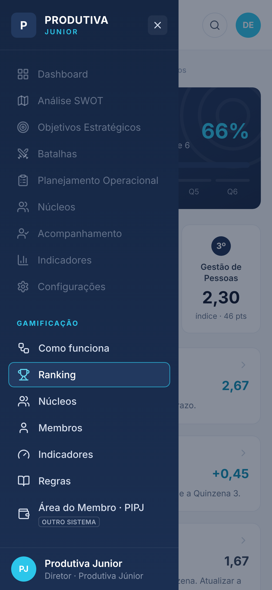{width=45%}

## 7. Tela Ranking

É a tela inicial do módulo.

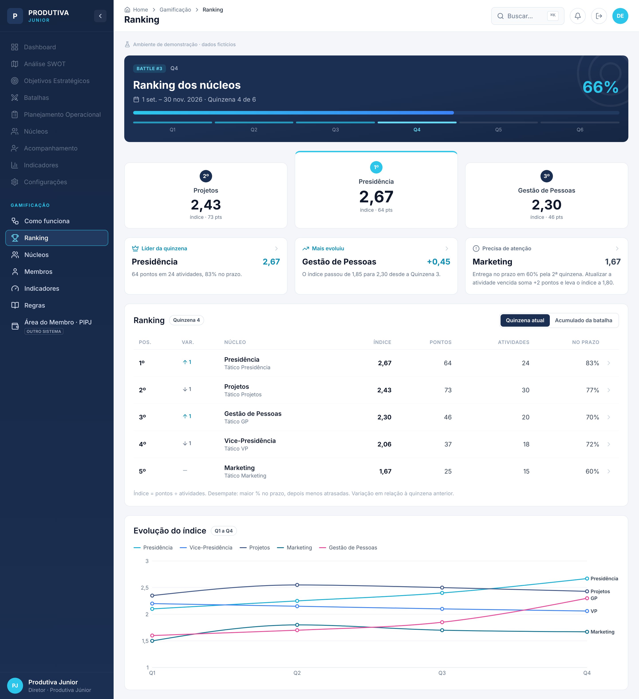

- **Cabeçalho da batalha:** mostra a Battle #3 (1 set. a 30 nov. 2026), a quinzena atual (4 de 6) e o progresso da batalha (66%).
- **Pódio:** os três primeiros núcleos, com o índice em destaque. Na Quinzena 4: Presidência (2,67), Projetos (2,43) e Gestão de Pessoas (2,30).
- **Três destaques:**
  - **Líder da quinzena:** Presidência, com 64 pontos em 24 atividades e 83% no prazo.
  - **Mais evoluiu:** Gestão de Pessoas, cujo índice subiu 0,45 (de 1,85 para 2,30).
  - **Precisa de atenção:** Marketing, com entrega no prazo em 60% pela 2ª quinzena seguida. O texto é construtivo e mostra o caminho: atualizar a atividade vencida soma 2 pontos e leva o índice a 1,80.
- **Tabela do ranking:** posição, variação desde a quinzena anterior (seta para cima, seta para baixo ou traço), núcleo, índice, pontos, atividades e percentual no prazo. Clicar numa linha abre o núcleo.
- **Gráfico de evolução:** o índice de cada núcleo da Q1 à Q4.

O alternador **Quinzena atual / Acumulado da batalha** troca a tabela pela visão acumulada, que mostra o índice de cada quinzena e a média:

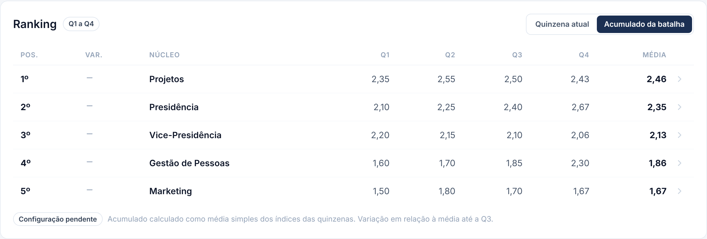

> O critério do acumulado (média simples dos índices) ainda é uma configuração pendente.

## 8. Tela Núcleos

Mostra tudo o que um núcleo precisa saber sobre a sua quinzena. O seletor no topo troca o núcleo.

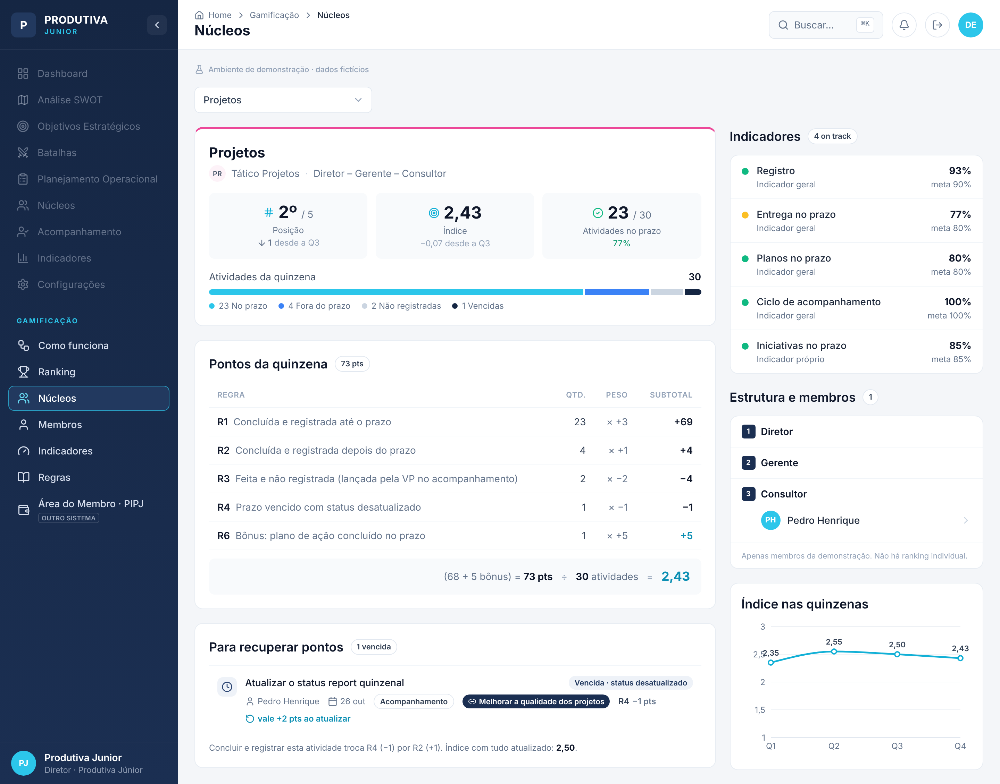

- **Cabeçalho:** nome do núcleo, tático, estrutura de cargos e três números: posição, índice e atividades entregues no prazo. A barra mostra a situação das atividades (no prazo, fora do prazo, não registradas e vencidas).
- **Pontos da quinzena:** a conta completa, regra por regra (quantidade × peso = subtotal), mais os bônus, até chegar ao índice. Qualquer membro consegue conferir de onde veio o resultado.
- **Para recuperar pontos:** as atividades vencidas com status desatualizado e quanto cada uma vale se for concluída e registrada (+2 pontos, porque passa de R4 para R2). Também mostra qual seria o índice se tudo fosse atualizado.
- **Indicadores:** os 4 indicadores gerais e o indicador próprio do núcleo, com valor, meta e cor do semáforo. Um indicador vermelho pela 2ª quinzena seguida ganha a etiqueta "Vai para a pauta da RN".
- **Estrutura e membros:** os cargos do núcleo em ordem hierárquica, com os membros da demonstração em cada nível.
- **Índice nas quinzenas:** a evolução do núcleo da Q1 à Q4.

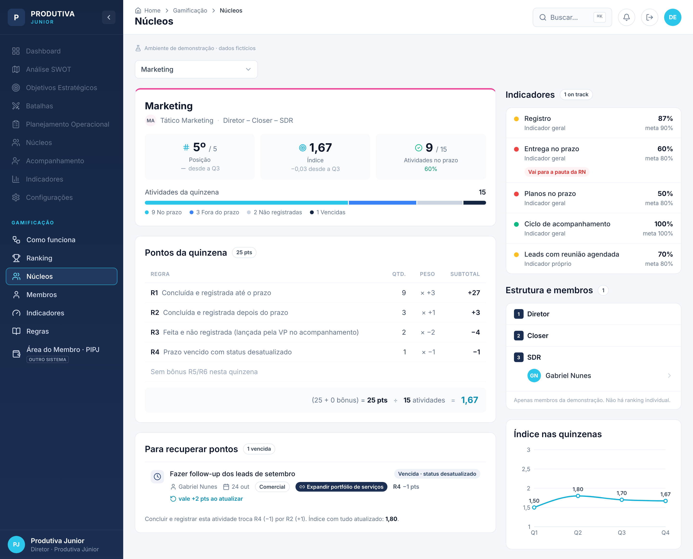

## 9. Tela Membros

Mostra a quinzena de um membro **sem posição individual e sem comparação com outros membros**. Os pontos de cada pessoa contam para o núcleo.

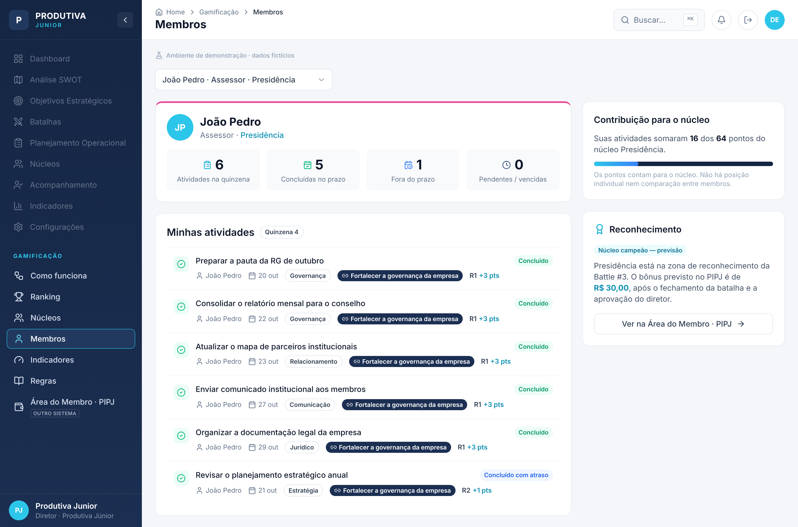

- **Números da quinzena:** atividades, concluídas no prazo, fora do prazo e pendentes/vencidas.
- **Minhas atividades:** a lista no mesmo estilo das Ações Operacionais do sistema, com status, prazo, etiqueta, objetivo vinculado e a regra aplicada.
- **Contribuição para o núcleo:** por exemplo, "Suas atividades somaram 16 dos 64 pontos do núcleo Presidência".
- **Reconhecimento:** informa se o núcleo está na zona de reconhecimento (campeão ou que mais evoluiu) e leva para a Área do Membro · PIPJ.

## 10. Tela Indicadores (visão da VP)

É a ferramenta de trabalho da gerente e dos assessores da VP para preparar a RN.

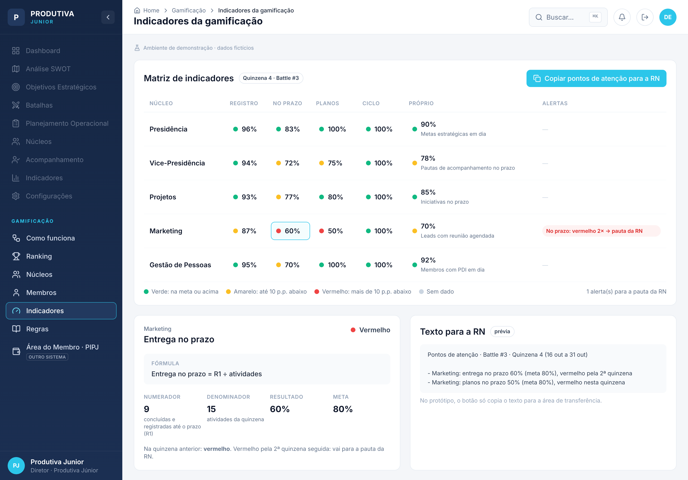

- **Matriz núcleos × indicadores:** Registro, No prazo, Planos, Ciclo e Próprio, cada célula com a cor do semáforo.
- **Detalhe da célula:** ao clicar numa célula, aparecem a fórmula, o numerador, o denominador, o resultado e a meta. Exemplo: Marketing, entrega no prazo = 9 ÷ 15 = 60% (meta 80%).
- **Coluna de alertas:** marca os indicadores vermelhos por 2 quinzenas seguidas.
- **Botão "Copiar pontos de atenção para a RN":** gera um texto pronto com os números. Exemplo: "Marketing: entrega no prazo 60% (meta 80%), vermelho pela 2ª quinzena".

| Indicador | Fórmula | Meta |
| --- | --- | --- |
| Registro | (atividades − R3) ÷ atividades | 90% |
| No prazo | R1 ÷ atividades | 80% |
| Planos no prazo | planos concluídos no prazo ÷ planos com prazo na quinzena | 80% |
| Ciclo de acompanhamento | acompanhamentos realizados ÷ acompanhamentos previstos | 100% |
| Próprio | definido por cada núcleo | definida por cada núcleo |

## 11. Tela Regras

Reúne, num só lugar, as regras R1 a R6 (com a etiqueta "Proposta em validação"), a fórmula do índice, o desempate, o semáforo e os critérios de reconhecimento.

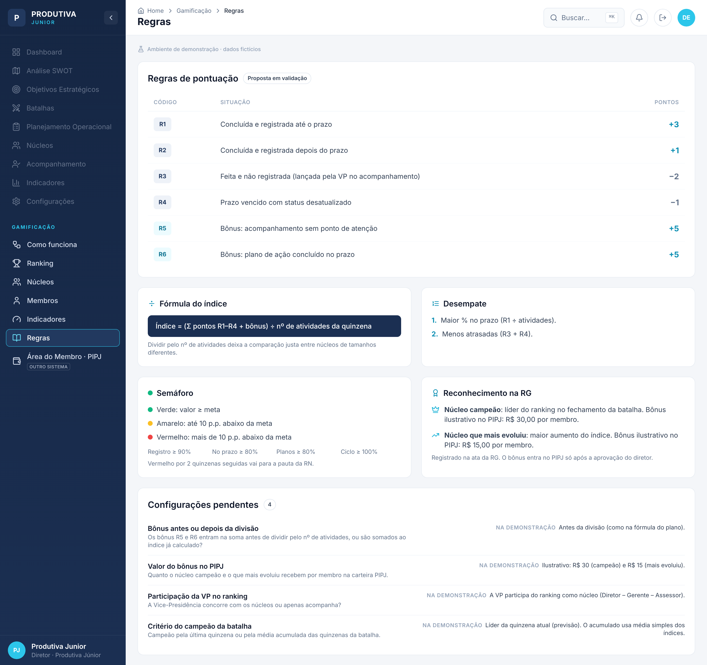

No fim da tela ficam as **configurações pendentes**, que precisam de decisão da diretoria:

- **Bônus antes ou depois da divisão:** na demonstração, o bônus entra antes da divisão pelo número de atividades.
- **Valor do bônus no PIPJ:** na demonstração, R$ 30,00 para o núcleo campeão e R$ 15,00 para o que mais evoluiu, por membro.
- **Participação da VP no ranking:** na demonstração, a VP participa como núcleo.
- **Critério do campeão da batalha:** última quinzena ou média acumulada.

## 12. Reconhecimento e PIPJ

Ao fim de cada batalha, dois núcleos entram na **zona de reconhecimento**:

- o **núcleo campeão**, líder do ranking;
- o **núcleo que mais evoluiu**, com o maior aumento do índice.

O reconhecimento é registrado na ata da RG. Além disso, pode virar um **bônus de reconhecimento** no crédito do PIPJ de cada membro do núcleo, desde que o diretor aprove.

O PIPJ fica em outro sistema, a **Área do Membro**. Lá o membro tem uma carteira com créditos para gastos de desenvolvimento: até R$ 300,00 por pedido, com comprovante, nas categorias capacitação, papelaria, MEJ, eventos sênior e tecnologia. A gamificação não aparece na Área do Membro. O membro só vê o efeito dela: o aumento do saldo pelo bônus.

## 13. Área do Membro · PIPJ

Esta tela simula o outro sistema. Por isso tem um visual diferente, sem a barra lateral da VP, e um botão para voltar ao sistema estratégico.

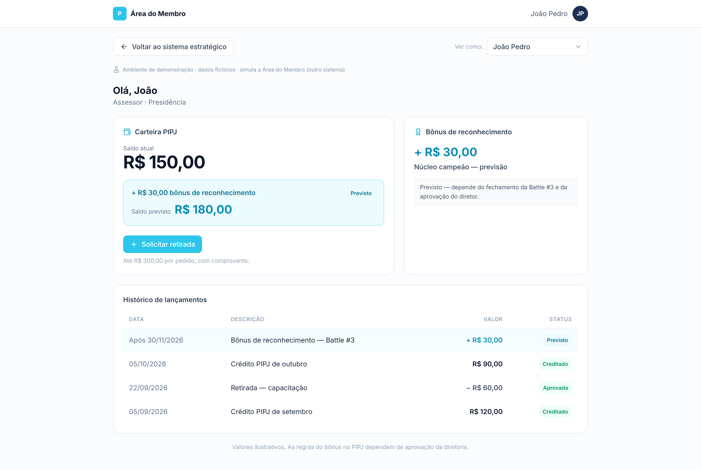

- **Carteira PIPJ:** saldo atual de R$ 150,00 e, em destaque, o aumento previsto de R$ 30,00, que leva o saldo previsto a R$ 180,00.
- **Bônus de reconhecimento:** aparece como "Previsto — depende do fechamento da Battle #3 e da aprovação do diretor".
- **Histórico de lançamentos:** data, descrição, valor e status de cada crédito e retirada.

Quem não está num núcleo reconhecido vê a mensagem "Seu núcleo ainda não está na zona de reconhecimento nesta batalha":

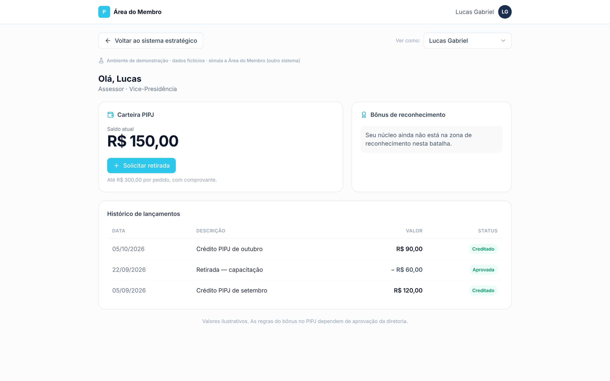

O botão **Solicitar retirada** abre um formulário demonstrativo com categoria, valor (até R$ 300,00), justificativa e comprovante. Ao enviar, o sistema mostra "Solicitação simulada — nenhuma operação real foi feita".

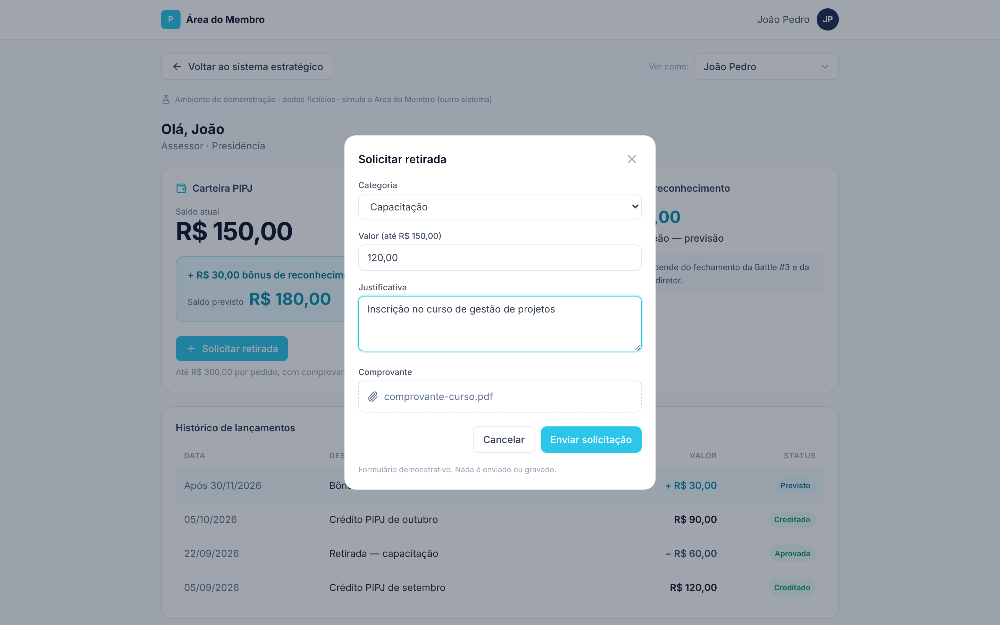

## 14. Resultado da Quinzena 4 (dados da demonstração)

| Posição | Núcleo | Pontos | Atividades | No prazo | Índice | Variação |
| --- | --- | --- | --- | --- | --- | --- |
| 1º | Presidência | 64 | 24 | 83% | 2,67 | subiu 1 |
| 2º | Projetos | 73 | 30 | 77% | 2,43 | caiu 1 |
| 3º | Gestão de Pessoas | 46 | 20 | 70% | 2,30 | subiu 1 |
| 4º | Vice-Presidência | 37 | 18 | 72% | 2,06 | caiu 1 |
| 5º | Marketing | 25 | 15 | 60% | 1,67 | manteve |

- **Zona de reconhecimento (previsão):** Presidência (campeã) e Gestão de Pessoas (mais evoluiu, +0,45).
- **Ponto de atenção para a RN:** Marketing, com entrega no prazo vermelha pela 2ª quinzena seguida.

## 15. Próximos passos

1. Validar as regras de pontuação e as metas com a diretoria.
2. Decidir as configurações pendentes (bônus, valor no PIPJ, participação da VP e critério do campeão).
3. Definir o indicador próprio de cada núcleo.
4. Definir como os dados do Monday chegam ao sistema estratégico.
5. Aprovar o uso do bônus de reconhecimento no PIPJ.

## 16. Acesso ao protótipo

O protótipo está publicado na Vercel e pode ser incorporado no Google Sites (Inserir → Incorporar → URL). Ele abre direto na tela de Ranking, sem login, e não tem nenhuma integração real: todos os dados são fictícios e ficam só na página.
